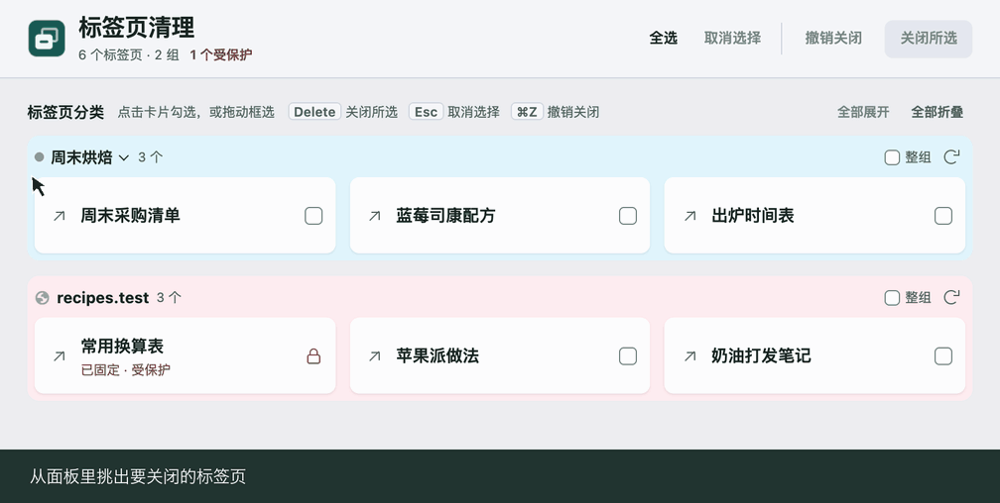
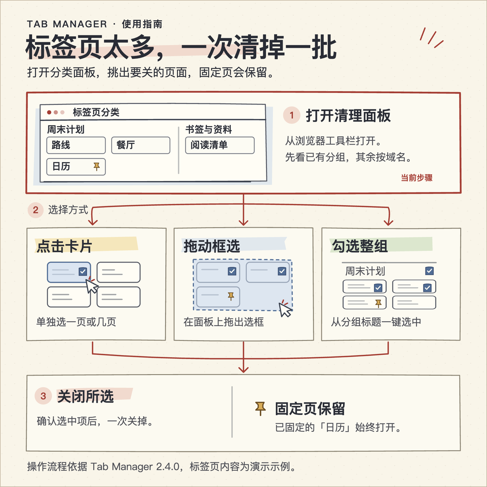

# Tab Manager · 标签页清理

**[直接下载 v2.4.4 ZIP][release-zip]** · [安装步骤（Chrome / Ego Lite）](#安装)

浏览器开了好几个窗口，临时查资料的标签页散得到处都是。逐个翻找再关，既慢又容易关掉还要用的页面。Tab Manager 把各窗口的标签页铺在同一个面板里，优先沿用浏览器已有的标签页分组，其余按域名归类。你可以选好一批一起关，已固定的标签页会保留。

[项目主页 · Project website](https://ximendatie.github.io/tab-manager/)

## 使用演示

### 插件实拍



[查看框选截图](docs/extension-screenshot.png)。图中使用示例标签页，浅色底纹标示分组，带锁的白底卡片表示固定页。

### 交互指南

[](https://ximendatie.github.io/tab-manager/usage.html)

[打开交互演示](https://ximendatie.github.io/tab-manager/usage.html)，任选一种选择方式，再点击「关闭所选」看结果。演示使用示例标签页。

## 安装

1. [下载 v2.4.4 ZIP][release-zip] 并解压。
2. 在 Chrome 或 Ego Lite 的地址栏打开 `chrome://extensions`，开启右上角的「开发者模式」。
3. 点击「加载未打包的扩展程序」，选择解压后包含 `manifest.json` 的 `tab-manager` 文件夹。
4. 从浏览器工具栏的扩展程序菜单打开「标签页清理」。常用的话，可以点击菜单里的图钉把它固定在工具栏。

## 批量清理标签页

1. **打开面板。** 点击工具栏里的扩展图标。面板汇总当前浏览器个人资料中各窗口的标签页。已有分组沿用原组名，未分组的标签页按域名归类。
2. **选出要关闭的标签页。** 点击卡片或复选框可逐个勾选。从卡片或空白处按住鼠标左键拖动可框选多张，框选可以累加。要处理整个分组，勾选组标题旁的「整组」。
3. **核对后关闭。** 点击卡片左侧的网站图标或跳转箭头可切换到原标签页查看。确认勾选项后，点击「关闭所选」。想重新选时可以点「取消选择」，也可以按 `Esc`。

已固定的标签页会从单选、整组、框选和全选中排除。执行批量关闭前，扩展会再检查一次固定状态。

## 自定义域名组名

在 `manifest.json` 同级创建 `domain-labels.local.json`。键填主机名，值填要显示的组名。主机名省略协议、端口和路径，`www.` 前缀会自动归一。

```json
{
  "recipes.example.com": "食谱",
  "guides.example.com": { "groupWith": "recipes.example.com" }
}
```

配置 `groupWith` 可将一个域名归入另一个域名组。保存后刷新管理页。未配置简称时显示域名，悬停组名可查看域名。配置文件已加入 `.gitignore`。

## 常见问题

### 能跨窗口批量关闭标签页吗？

可以。面板会汇总当前浏览器个人资料里各个普通窗口的标签页。你可以跨组拖动框选，也可以点击卡片或使用「整组」，再点击「关闭所选」。

### 固定标签页会被框选或关闭吗？

固定页会留在面板里并标有锁。即使框选范围覆盖了固定页，它也不会被选中。点击「关闭所选」后，扩展会再次检查固定状态并跳过已固定的标签页。

### 怎么在 Chrome 或 Ego Lite 安装？

从 GitHub Releases 下载扩展 ZIP 并解压。在地址栏打开 `chrome://extensions`，开启「开发者模式」，点击「加载未打包的扩展程序」，选择包含 `manifest.json` 的目录。

### 标签页标题和域名简称会上传吗？

扩展在本地处理标签页标题和网址，域名简称也从本机配置文件读取。

## FAQ in English

### Can I close tabs across multiple browser windows?

Yes. The dashboard lists tabs from every normal window in the current browser profile. Drag a selection box across groups, click individual cards, or select an entire group, then click **Close selected** (`关闭所选`).

### Does bulk closing affect pinned tabs?

Pinned tabs stay open. Their cards show a lock and are skipped when you drag-select tabs. The extension checks pin status again before closing the selected tabs.

### How do I install Tab Manager in Chrome or Ego Lite?

Download and unzip the extension from GitHub Releases. Open `chrome://extensions`, turn on **Developer mode**, select **Load unpacked**, and choose the folder containing `manifest.json`.

### Does the extension upload my tab titles or domain aliases?

The extension processes tab titles and URLs locally. It reads domain aliases from the optional `domain-labels.local.json` file alongside the manifest.

[release-zip]: https://github.com/ximendatie/tab-manager/releases/download/v2.4.4/tab-manager-v2.4.4.zip
